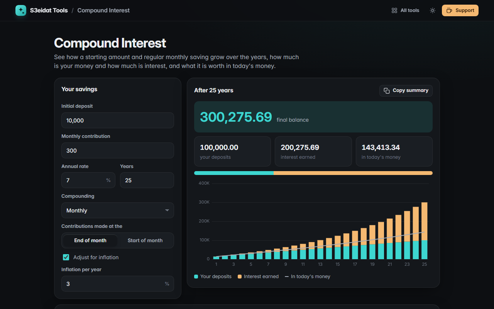

# Compound Interest

> See your savings grow: initial deposit, monthly contributions, any compounding frequency, and the value in today's money. Free, private, and it runs entirely in your browser.

### ▶ [Open Compound Interest](https://s3eidat.github.io/compound-interest/)



## Features

- **Initial deposit** plus a **monthly contribution**, made at the start or end of each month
- **Compounding** yearly, half-yearly, quarterly, monthly, daily or continuously
- **Final balance**, total deposits and **interest earned**, with a bar showing how much is your money vs interest
- **Inflation adjustment**: see the final balance in today's money
- **Stacked growth chart** per year (deposits vs interest), with the inflation-adjusted value as a line
- **Year-by-year table**; copy a summary or export **CSV**
- Remembers your last inputs on this device

Monthly contributions are combined with the chosen compounding frequency using the equivalent monthly rate. It is a projection with a fixed rate; real returns vary and fees and taxes are not included. Not financial advice.

## Privacy

Your numbers never leave your device. There is no server, no account, no analytics.
The page ships with a strict Content-Security-Policy (`connect-src 'self'`), so the browser
itself blocks any attempt to send data anywhere.

## Run it yourself

It's plain HTML, CSS and JavaScript with no build step:

```bash
git clone https://github.com/s3eidat/compound-interest
cd compound-interest
python -m http.server 8000
```

Then open http://localhost:8000.

## Support

If this saved you time, **[buy me a coffee ☕](https://s3eidat.github.io/coffee/)**. It keeps every tool free.

---

Part of **[S3eidat Tools](https://s3eidat.github.io/)**: 100+ free, private tools that run in your browser. MIT licensed.
